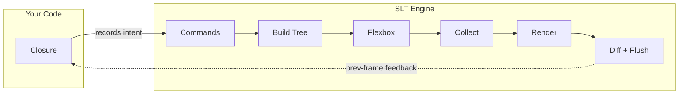

<div align="center">

# SuperLightTUI

**Build terminal UIs like web pages** — flexbox layout, Tailwind-style chaining, hooks, and click/hover/scroll, all in one Rust closure.

**Superfast** to write. **Superlight** dependency tree (4 direct required deps, 26 resolved with default features vs 67 for ratatui 0.30.2 + crossterm, measured 2026-10).

[![Crate Badge]][Crate]
[![Docs Badge]][Docs]
[![CI Badge]][CI]
[![MSRV Badge]][Crate]
[![Downloads Badge]][Crate]
[![License Badge]][License]

[Docs Index] · [Quick Start] · [Widget Guide] · [Patterns Guide] · [Examples Guide] · [Backends Guide] · [Architecture Guide]

**English** · [中文](docs/README.zh-CN.md) · [Español](docs/README.es.md) · [日本語](docs/README.ja.md) · [한국어](docs/README.ko.md)

</div>

SuperLightTUI (SLT) is an immediate-mode TUI library for Rust with a deliberately small public grammar.
You write one closure, SLT calls it every frame, and the library handles layout, focus, diffing, and rendering.
State is plain Rust variables; there is no app trait, message enum, or retained widget tree to set up.

## Quick Start

```sh
cargo add superlighttui
```

```rust
fn main() -> std::io::Result<()> {
    slt::run(|ui: &mut slt::Context| {
        ui.text("hello, world");
    })
}
```

5 lines. No `App` trait. No `Model`/`Update`/`View`. No manual event loop.
Ctrl+C exits cleanly by default (opt out with `RunConfig::handle_ctrl_c(false)`).

Mouse capture is **opt-in**. Plain `slt::run` is keyboard-driven: Tab/Shift+Tab move
focus and Enter/Space activate the focused button. For click, hover, wheel scroll,
and drag, start the loop with `RunConfig::default().mouse(true)`:

```rust
use slt::{Context, RunConfig};

fn main() -> std::io::Result<()> {
    let mut clicks = 0;

    slt::run_with(RunConfig::default().mouse(true), |ui: &mut Context| {
        ui.text(format!("clicked {clicks} times")).bold();
        if ui.button("Click me").clicked {
            clicks += 1;
        }
    })
}
```

MSRV: Rust 1.88. Default features enable the `crossterm` backend and `bidi`.

## Showcase

<table>
  <tr>
    <td align="center"><br/><b>Widget Demo</b><br/><sub><code>cargo run --example demo</code></sub></td>
    <td align="center"><br/><b>Dashboard</b><br/><sub><code>cargo run --example showcase_tour</code></sub></td>
    <td align="center"><br/><b>Website Layout</b><br/><sub><code>cargo run --example showcase_tour</code></sub></td>
  </tr>
  <tr>
    <td align="center"><br/><b>Spreadsheet</b><br/><sub><code>cargo run --example showcase_tour</code></sub></td>
    <td align="center"><br/><b>Games</b><br/><sub><code>cargo run --example canvas_tour</code></sub></td>
    <td align="center"><br/><b>DOOM Fire Effect</b><br/><sub><code>cargo run --example canvas_tour</code></sub></td>
  </tr>
  <tr>
    <td align="center" colspan="3"><br/><b><a href="https://github.com/chenglou/pretext">Pretext</a> Reflow</b> — text reflows around the mouse cursor in real time<br/><sub><code>cargo run --example text_tour</code></sub></td>
  </tr>
</table>

## 60-Second Grammar

There are four ideas most apps start with:

1. State lives in normal Rust variables or structs.
2. Layout is mostly `row()`, `col()`, and `container()`.
3. Styling is method chaining.
4. Interactive widgets usually return `Response`.

```rust
ui.bordered(Border::Rounded).title("Status").p(1).gap(1).col(|ui| {
    ui.text("SLT").bold().fg(Color::Cyan);
    ui.row(|ui| {
        ui.text("mode:");
        ui.text("ready").fg(Color::Green);
        ui.spacer();
        if ui.button("Quit").clicked {
            ui.quit();
        }
    });
});
```

That is the core mental model. Everything else is depth, not a second framework.
`clicked` fires on Enter/Space when the button is focused, and on mouse click when
the loop runs with `RunConfig::default().mouse(true)`.

## A Real App

```rust
use slt::{Border, Color, Context, KeyCode};

fn main() -> std::io::Result<()> {
    let mut count: i32 = 0;

    slt::run(|ui: &mut Context| {
        if ui.key('q') {
            ui.quit();
        }
        if ui.key('k') || ui.key_code(KeyCode::Up) {
            count += 1;
        }
        if ui.key('j') || ui.key_code(KeyCode::Down) {
            count -= 1;
        }

        ui.bordered(Border::Rounded).title("Counter").p(1).gap(1).col(|ui| {
            ui.text("Counter").bold().fg(Color::Cyan);
            ui.row(|ui| {
                ui.text("Count:");
                let color = if count >= 0 { Color::Green } else { Color::Red };
                ui.text(format!("{count}")).bold().fg(color);
            });
            ui.text("k +1 / j -1 / q quit").dim();
        });
    })
}
```

## Runtime Modes

The same closure runs across several entry points. Pick one based on UI shape, not size.

| Mode | API | When to use |
|------|-----|-------------|
| Full-screen | `slt::run` / `slt::run_with` | Standard TUI app on the alternate screen. Mouse capture is off unless `RunConfig::mouse(true)` is passed to `run_with`. |
| Inline | `slt::run_inline` / `slt::run_inline_with` | Fixed-height widget below the prompt — no alternate screen. |
| Static + inline | `slt::run_static` | Log lines stream into scrollback while an inline UI stays live below. |
| Async messages | `slt::run_async` *(feature: `async`)* | Background tasks use the wake-aware `AsyncSender`; retain the returned `AsyncRunHandle` to join or cancel the loop. |
| Custom backend | `slt::frame` + `Backend` + `AppState` | Drive rendering yourself — tests, GUI embeds, WASM, snapshot harnesses. |

`RunConfig` tunes mouse capture (default: off), kitty keyboard, color depth, max FPS, scroll speed, theme, title, and Ctrl+C handling across every mode.

## Focus and Scrolling

Scrollable containers reveal the focused widget when focus, caret, or layout
changes, including nested horizontal/vertical views and modal forms. Manual
scrolling is preserved between those changes; set `scroll.follow_focus = false`
for application-controlled positioning. Keep one `ScrollState` per container.

Use `ui.form_field_response(...)` for field/input interaction feedback without
changing existing `ui.form_field(...)` callers. `ui.focused_layout_rect()` and
`ui.measured_layout_rect(name)` expose previous-frame geometry before scrolling
and clipping; `Response.rect` remains the visible mouse-hit rectangle.
See [the migration guide](docs/MIGRATION.md) for the coordinate and timing rules.

## Feature Flags

```toml
[dependencies]
superlighttui = { version = "0.25.0", features = ["async", "image"] }
```

| Feature | What it adds |
|---------|--------------|
| `async` | `tokio` + `run_async` for background message loops |
| `bidi` | UAX #9 bidirectional text reordering; enabled by default |
| `serde` | `Serialize`/`Deserialize` on selected state types |
| `theme-watch` | TOML theme hot reload (`serde` + filesystem watcher) |
| `image` | PNG/JPEG decoding for `ui.image` |
| `qrcode` | QR code rendering |
| `kitty-compress` | zlib compression for the Kitty image protocol |
| `syntax` | Tree-sitter highlighting for all bundled languages |
| `syntax-<lang>` | Highlighting for a single language (`rust`, `python`, `typescript`, ...) |
| `full` | `crossterm + async + serde + theme-watch + image + qrcode + kitty-compress + bidi` — **does not** include `syntax` (grammars are heavy; opt in explicitly) |

## Why SLT

- **Small public grammar**. Most screens start with normal Rust state, `row()` / `col()` / `container()`, method chaining, and `Response`.
- **Less framework ceremony**. Many apps do not need an app trait, retained tree, or message enum just to get moving.
- **Batteries included, backend still serious**. Common widgets auto-wire focus, hover, click, and scroll behavior (mouse events once `RunConfig::mouse(true)` is set), while the runtime keeps a conservative low-level path through `Backend`, `AppState`, and `frame()`.
- **Conservative internals**. SLT keeps the public surface small, but the internals stay deliberately boring: shared frame kernel, explicit backend contract coverage, zero `unsafe`, feature-gated runtime paths, and validation across `all-features`, `no-default-features`, WASM, clippy, examples, cargo-hack, semver, and deny checks.

For Rust users, that usually means less setup than retained-mode TUI frameworks.
For AI-assisted workflows, it means the public grammar is easy to infer from docs and examples.

SLT fits best when you want to build terminal apps quickly without giving up Rust type safety or backend escape hatches.
If you want a retained component tree or a GUI-first toolkit, another library may be a better fit.

## How It Renders

SLT's rendering pipeline is why the grammar stays small.
Your code only touches the first stage — the engine handles the rest.



Every `ui.*()` call records a command to a flat list — no tree construction, no layout math.
The engine replays those commands through a **four-stage DFS pipeline** — each stage specializes: build the layout tree, compute flexbox, collect interaction and feedback data, render cells to a back buffer — then diffs against the previous frame and flushes only what changed.

This architecture is what makes the simple grammar possible:

- **No ceremony.** Immediate-mode means no `App` trait, no `Model`/`Message`/`Update`/`View`. Your closure is the entire UI. State is normal Rust variables. Control flow is `if`/`for`.
- **Invisible layout.** `ui.col(|ui| { ... })` records an "open column" command. The engine builds the tree and runs flexbox — you never see `LayoutNode`.
- **Automatic diffing.** The double-buffer diffs cells between frames and only emits changed ANSI attributes. You redraw everything; the engine decides what to write. No manual dirty tracking. Per-frame cost is currently higher than ratatui's on matched workloads; see the [Performance Guide](docs/PERFORMANCE.md) for measurements.
- **Auto-wired interaction.** `ui.button("Save")` gets keyboard focus and Enter/Space activation for free; with `RunConfig::mouse(true)` it also reports hover and click. No hit-testing code on your side.
- **Synchronous feedback.** Interaction uses the previous frame's layout positions (imperceptible at 60 FPS). No callbacks, no async layout queries — your code stays linear.

For the full eight-stage lifecycle, see [Architecture Guide].

## Common API Surface

Stateless calls take values; stateful widgets take an explicit state struct so your data
keeps living in normal Rust variables across frames.

```rust
// Text and layout
ui.text("Hello").bold().fg(Color::Cyan);
ui.row(|ui| {
    ui.text("left");
    ui.spacer();
    ui.text("right");
});

// Inputs and actions
ui.text_input(&mut input);          // input: TextInputState
if ui.button("Save").clicked {}   // Enter/Space; mouse click needs mouse(true)
ui.checkbox("Dark mode", &mut dark);

// Data and navigation
ui.tabs(&mut tabs);                 // tabs: TabsState
ui.list(&mut list);                 // list: ListState
ui.table(&mut table);               // table: TableState
ui.command_palette(&mut palette);   // palette: CommandPaletteState

// Overlays and rich output
ui.toast(&mut toasts);              // toasts: ToastState
ui.modal(|ui| {
    ui.text("Confirm?").bold();
});
ui.markdown("# Hello **world**");

// Visualization
ui.chart(|c| {
    c.line(&data);
    c.grid(true);
}, 50, 16);
ui.sparkline(&values, 16);
ui.canvas(40, 10, |cv| {
    cv.circle(20, 20, 15);
});
```

State structs (`ListState`, `TableState`, `TextInputState`, `TabsState`, `CommandPaletteState`,
`ToastState`, `FilePickerState`, `RichLogState`, ...) are public — keep them in your app
struct or local variables and pass them in each frame.

For the categorized widget list, see [Widget Guide].
For composition advice, see [Patterns Guide].

## Learn The Library

| Document | What it covers |
|----------|----------------|
| [Quick Start] | Install, first app, closure mental model, layout, widget state |
| [Widget Guide] | Complete API catalog of widgets, runtime methods, and state types |
| [Cookbook] | Copy-paste recipes for common apps, each backed by a runnable example |
| [Web Developers Guide] | Coming from web: CSS/React → SLT mapping |
| [Interaction Guide] | Mouse, click, hover, drag, wheel, expand/collapse, hit-testing |
| [Positioning Guide] | `Anchor` and overlay APIs mapped to CSS/Flutter/React Native positioning |
| [State API Guide] | Public fields, accessors, and mutation methods for widget state |
| [Migration Guide] | Version-by-version breaking changes and upgrade paths |
| [Patterns Guide] | State placement, screen composition, helper extraction, large-app structure |
| [Examples Guide] | Runnable examples grouped by product shape and feature area |
| [Backends Guide] | `Backend`, `AppState`, `frame()`, inline mode, static output |
| [Testing Guide] | `TestBackend`, `EventBuilder`, multi-frame tests, backend contract tests |
| [Debugging Guide] | F12 overlay, clipping, focus surprises, previous-frame behavior |
| [Previous Frame Guide] | Why interaction uses last-frame layout, when `Response.rect` is zero, frame-1 correctness |
| [Terminal Compatibility] | Terminal/multiplexer/SSH support matrix, env vars, fallbacks |
| [AI Guide] | Fastest path for AI-assisted builders and coding agents |
| [Architecture Guide] | Module map, frame lifecycle, layout/render pipeline |
| [Features Guide] | Feature flags, optional dependencies, recommended combos |
| [Animation Guide] | Tween, spring, keyframes, sequence, stagger |
| [Theming Guide] | Theme struct, presets, ThemeBuilder, custom themes |
| [Design Principles] | API constraints and design philosophy |
| [API Design] | Five consistency rules for new widgets and PR review checklist |

## Representative Examples

| Example | Command | Focus |
|---------|---------|-------|
| `hello` | `cargo run --example hello` | Smallest possible app |
| `counter` | `cargo run --example counter` | State + keyboard input |
| `demo` | `cargo run --example demo` | Broad widget tour |
| `showcase_tour` | `cargo run --example showcase_tour` | Dashboard, design system, infoviz, trading, spreadsheet, table, and website layouts |
| `cookbook_tour` | `cargo run --example cookbook_tour` | Form, table, modal, file picker, dashboard recipes |
| `text_tour` | `cargo run --example text_tour` | CJK rendering, IME input, Pretext reflow, cargo-style CLI |
| `canvas_tour` | `cargo run --example canvas_tour` | DOOM fire, games (tetris/snake/minesweeper), raw draw, Kitty images, animation |
| `system_tour` | `cargo run --example system_tour --features async` | Live error boundary and overlay anchor tabs; async and inline modes described as code |
| `widgets_tour` | `cargo run --example widgets_tour` | Hooks, theming, modal focus traps, layout helpers, and static output (`run_static`) |
| `interaction_tour` | `cargo run --example interaction_tour` | Click / double-click / scroll `Response` signals, `KeyMap`, focus traversal |

The full categorized index — including per-release feature tours and showcase demos — lives in [Examples Guide].

### Demo Launcher

`scripts/ghostty_demos.sh` opens demos in fresh Ghostty windows, which is
useful for skimming the full set side by side. See [Examples Guide] for the
list of demos at each release.

```bash
./scripts/ghostty_demos.sh             # interactive picker
./scripts/ghostty_demos.sh --features  # full feature-tour spread
./scripts/ghostty_demos.sh --showcase  # integration showcases only
```

## Custom Widgets And Backends

- Implement `Widget` when you want reusable high-level building blocks.
- Implement `Backend` and drive `frame()` when you want a non-terminal target, external event loop, or embedded runtime.
- Use `TestBackend` for headless rendering checks and stable interaction tests.

The public grammar stays small even when you need the escape hatches.

## Contributing

Read [Contributing], then [Design Principles] and [Architecture Guide].
The release process expects format, check, clippy, tests, examples, and backend gates to stay green.

## License

[MIT](LICENSE)

<!-- Badge definitions -->
[Crate Badge]: https://img.shields.io/crates/v/superlighttui?style=flat-square&logo=rust&color=E05D44
[Docs Badge]: https://img.shields.io/docsrs/superlighttui?style=flat-square&logo=docs.rs
[CI Badge]: https://img.shields.io/github/actions/workflow/status/subinium/SuperLightTUI/ci.yml?branch=main&style=flat-square&label=CI
[MSRV Badge]: https://img.shields.io/crates/msrv/superlighttui?style=flat-square&label=MSRV
[Downloads Badge]: https://img.shields.io/crates/d/superlighttui?style=flat-square
[License Badge]: https://img.shields.io/crates/l/superlighttui?style=flat-square&color=1370D3

<!-- Link definitions -->
[CI]: https://github.com/subinium/SuperLightTUI/actions/workflows/ci.yml
[Crate]: https://crates.io/crates/superlighttui
[Docs Index]: docs/README.md
[Docs]: https://docs.rs/superlighttui
[Backends Guide]: docs/BACKENDS.md
[Testing Guide]: docs/TESTING.md
[Debugging Guide]: docs/DEBUGGING.md
[AI Guide]: docs/AI_GUIDE.md
[Quick Start]: docs/QUICK_START.md
[Widget Guide]: docs/WIDGETS.md
[State API Guide]: docs/STATE_APIS.md
[Migration Guide]: docs/MIGRATION.md
[Examples Guide]: docs/EXAMPLES.md
[Patterns Guide]: docs/PATTERNS.md
[Architecture Guide]: docs/ARCHITECTURE.md
[Design Principles]: docs/DESIGN_PRINCIPLES.md
[API Design]: docs/API_DESIGN.md
[Animation Guide]: docs/ANIMATION.md
[Theming Guide]: docs/THEMING.md
[Features Guide]: docs/FEATURES.md
[Cookbook]: docs/COOKBOOK.md
[Previous Frame Guide]: docs/PREVIOUS_FRAME_GUIDE.md
[Positioning Guide]: docs/POSITIONING.md
[Web Developers Guide]: docs/WEB_DEVELOPERS.md
[Interaction Guide]: docs/INTERACTION.md
[Terminal Compatibility]: docs/TERMINAL_COMPATIBILITY.md
[Contributing]: CONTRIBUTING.md
[License]: ./LICENSE
